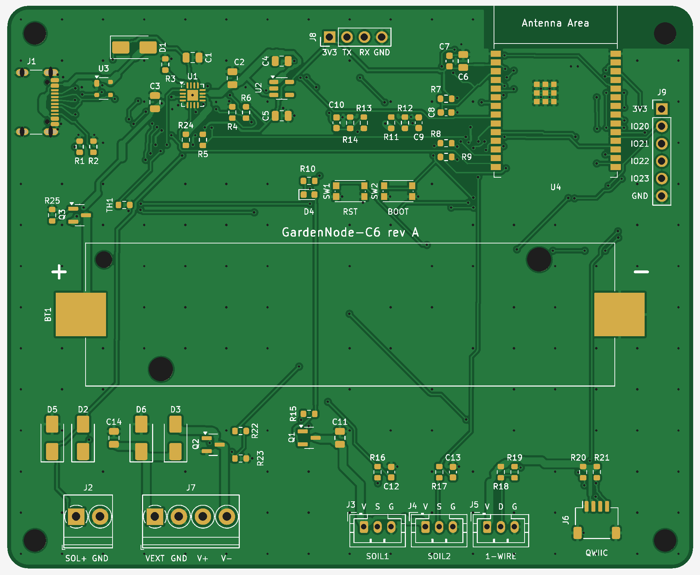

# GardenNode-C6

A solar-powered sensor node for gardens and greenhouses. It measures soil moisture, soil temperature, air temperature and humidity, then reports everything to Home Assistant over Wi-Fi. It can also switch a 12/24 V irrigation valve or pump.



**Status:** design complete (rev A). It hasn't been fabricated, so treat it as untested hardware.

## What it does

- Runs off a single 18650 cell, charged from a small 5–9 V solar panel or USB-C
- Wakes up every 10 minutes, takes readings, sends them, and goes back to sleep
- Two capacitive soil-moisture probes, one DS18B20 soil temperature probe, and a Qwiic port for an air sensor (SHT4x, SCD4x, etc.)
- Low-side valve driver for 5–24 V solenoids, with a 30-minute safety cut-off in firmware
- Reports battery and solar voltage so you can tell whether the panel is keeping up
- Fits in a 3D-printed, gasketed enclosure with cable glands

## Repo layout

```
hw/          KiCad schematic (+ PDF)
pcb/         KiCad board, DRC report, render
fab/         Gerbers, drill files, BOM, pick-and-place, assembly drawing
enclosure/   OpenSCAD source, STL and 3MF files
firmware/    ESPHome config
tools/       Python scripts that generate and check the design
```

## Hardware

**MCU:** ESP32-C6-WROOM-1. I picked it because it has Wi-Fi 6, Bluetooth LE and an 802.15.4 radio (Zigbee/Thread) in one FCC-certified module. It also has native USB, so the board doesn't need a USB-serial chip.

**Power:**
- **Charging:** USB-C and the solar input each go through a Schottky diode into a TI BQ24074 charger.
- **Solar handling:** the charger runs in USB500 mode, so its input-voltage regulation backs the current off when the panel sags. That's a cheap stand-in for proper MPPT.
- **Charge current:** set to about 0.6 A.
- **Temperature cut-off:** an NTC next to the cell stops charging below 0 °C or above 50 °C.
- **3.3 V rail:** a TLV75733 LDO, chosen for its 25 µA quiescent current.
- **Backwards cell:** a P-channel MOSFET between the cell and the charger blocks it if the cell is inserted the wrong way round.

**Sensors:**
- **Sensor rail:** the probes are powered from a switched 3.3 V rail (P-FET on GPIO4), so they draw nothing while the node sleeps.
- **Soil probes:** each input has a 1 k / 10 nF RC filter in front of the ADC.
- **1-Wire:** the bus has a 4.7 k pull-up.

**Valve output:**
- **Switch:** a DMN3404L low-side MOSFET.
- **Protection:** a flyback diode across the valve, plus a TVS diode on the supply input.

| GPIO | Use | GPIO | Use |
|---|---|---|---|
| 0, 1 | Soil probes (ADC) | 9 | BOOT button |
| 2 | Battery voltage ÷2 | 10 | Valve |
| 3 | Solar voltage ÷4 | 11 | Status LED (active low) |
| 4 | Sensor power (low = on) | 12, 13 | USB D−/D+ |
| 5 | 1-Wire | 16, 17 | UART on J8 |
| 6, 7 | I²C SDA/SCL | 18, 19 | Charge / power-good status |
| 8 | Strapping pin, pulled up | 20–23 | Spare, on J9 |

## PCB

- 100 × 82 mm, 2 layers, 1.6 mm FR-4, 1 oz copper
- 0.2 mm minimum track/space, 0.3 mm vias, which any standard fab can build
- Power traces widened to 0.4–1.0 mm, necked down only at fine-pitch pins
- Ground pour on both sides with stitching vias
- Copper keepout on both layers under the module antenna
- No vias in component pads, except the thermal vias under the charger and the module
- All parts on the top side; every part in the BOM is stocked at Digi-Key and Mouser

DRC is clean, with no unconnected nets and no clearance errors. The few items left in `pcb/drc.rpt` are expected:
- **USB-C peg spacing:** the manufacturer's land pattern puts its alignment pegs slightly closer to the pads than my rule allows.
- **Thermal spokes:** a few single-spoke thermal reliefs.
- **Edge silkscreen:** two marks clipped at the board edge.

## Enclosure

The enclosure source is OpenSCAD, so all the dimensions are parameters at the top of the file.

**Print settings:** ASA (or PETG), 0.2 mm layers, 4 walls. The USB-C plug is printed in TPU.

**Hardware:**
- 4× M3 screws for the board
- 4× M3×12 screws for the lid
- 3× PG7 cable glands
- 2 mm silicone cord in the lid groove as a gasket
- An adhesive ePTFE vent over the small hole so it doesn't fog up inside

**Fit and mounting:** the board sits close to the USB wall so a normal USB-C cable reaches the port. Mount the box glands-down.

## Firmware

The firmware is ESPHome, in `firmware/gardennode-c6.yaml`.

1. Copy `secrets.example.yaml` to `secrets.yaml` and fill in your Wi-Fi details and an API key.
2. Build it from ESPHome Builder in Home Assistant, or run `esphome run gardennode-c6.yaml`.
3. Flash it over USB-C. If the board doesn't show up, hold BOOT and tap RESET.

**Day-to-day behaviour:**
- **Staying awake:** turn on "Stay awake" in Home Assistant when you want to update or calibrate the node. The node also stays awake while the valve is open.
- **Probe calibration:** read the raw voltage dry and in water, then set `soil_dry_v` and `soil_wet_v` to match.

## If you build one

Bring it up in this order:

1. Power it from a current-limited 5 V supply with no battery fitted. VSYS should read about 4.4 V and the 3.3 V rail 3.30 V.
2. Flash the firmware and compare the battery and solar readings against a multimeter.
3. Fit the cell and check that it charges.
4. Test a reversed cell once. The 3.3 V rail should stay at 0 V.
5. Connect a 6 V panel and check that it charges.
6. Run a 12 V valve from the valve output.
7. Measure the sleep current.

## Known limitations

- **Untested hardware:** not fabricated or tested yet.
- **No end-product FCC certification:** the module has its own modular approval, but the finished board doesn't.
- **USB charging margin:** the Schottky diode on USB costs about 0.35 V, so a weak USB supply will charge slowly.
- **Low-battery cut-out:** the LDO drops out at about 3.5 V on the cell, so usable capacity ends a little early.

## How it was made

The schematic and board are KiCad 7 files, the enclosure is OpenSCAD and the firmware is ESPHome. The netlist lives in `tools/design.py`, and the schematic, board and BOM are all generated from it. Routing was done with a custom grid router in `tools/router.py`. I developed the design with help from an AI assistant (Claude), then reviewed and iterated on it.

## License

TBD. I'm planning CERN-OHL-S for the hardware and MIT for the scripts and firmware.
